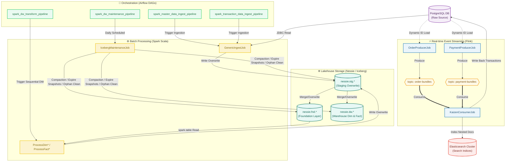

# 🚀 Kaizen Data Platform - Kiến Trúc & Hướng Dẫn Vận Hành

**Kaizen Data Platform** là hệ thống xử lý dữ liệu thời gian thực và phân tích lô quy mô lớn, được xây dựng theo mô hình **Event-Driven Streaming & Modern Lakehouse Architecture**. Hệ thống kết hợp Apache Flink (xử lý luồng), Apache Airflow (điều phối), Apache Spark (xử lý lô), cùng các kho lưu trữ PostgreSQL, Elasticsearch và Nessie/Iceberg Catalog.

---

## 🗺️ 1. Kiến Trúc Hệ Thống & Luồng Dữ Liệu (Data Flow)

Kiến trúc dữ liệu được tích hợp toàn diện qua hai luồng bổ trợ: **Real-time Event Streaming (Flink)** và **Batch Ingestion & DW Lakehouse (Spark & Nessie)**.



---

## 📂 2. Cấu Trúc Mã Nguồn (Repository Layout)

Mã nguồn được tổ chức module hóa theo tiêu chuẩn dự án lớn:

```bash
implements_new_dataplatform/
├── dags/                        # Module điều phối và sinh dữ liệu nền (Airflow)
│   ├── jobs/                    # Kịch bản sinh dữ liệu & Cấu hình bảng
│   │   ├── table_configs.yaml   # Cấu hình Metadata của tất cả các bảng (FND & Ingest)
│   │   └── spark_generic_ingest.py # Khởi tạo Task KubernetesPodOperator động cho Spark
│   ├── pipelines/               # Khai báo cấu trúc các DAG lập lịch Airflow
│   │   ├── spark_master_data_ingest_pipeline.py  # Ingestion Master Data (Full)
│   │   ├── spark_transaction_data_ingest_pipeline.py # Ingestion Giao dịch (Incremental)
│   │   ├── spark_dw_transform_pipeline.py        # DAG biến đổi Dimensions & Facts DW
│   │   ├── spark_dw_partition_realignment_pipeline.py # DAG quy hoạch phân hoạch 1 lần
│   │   └── spark_dw_maintenance_pipeline.py      # DAG chạy nén file bảo trì hàng ngày
│   └── deploy_airflow.sh        # Script đồng bộ DAGs lên Kubernetes (qua MinIO)
│
├── projects/
│   ├── stream-processing/       # Module xử lý luồng thời gian thực (Apache Flink - Java)
│   │   ├── src/main/java/
│   │   │   └── com/kaizen/flink/
│   │   │       ├── entrypoint/
│   │   │       │   ├── KaizenConsumerJob.java # Consumer tích hợp ghi Postgres & ES
│   │   │       │   ├── OrderProducerJob.java  # Producer sinh đơn hàng Pareto -> Kafka
│   │   │       │   └── PaymentProducerJob.java # Producer sinh giao dịch thanh toán -> Kafka
│   │   │       ├── simulate/
│   │   │       │   ├── IdPool.java            # Bộ đệm RAM lưu ID để đảm bảo tính toàn vẹn
│   │   │       │   ├── OrderSimulator.java    # Bộ giả lập đơn hàng phân phối Pareto
│   │   │       │   └── PaymentSimulator.java  # Bộ giả lập giao dịch thanh toán
│   │   │       ├── model/                 # POJO Java biểu diễn dữ liệu (Order, Payment,...)
│   │   │       ├── utils/                 # Hàm tiện ích kết nối JDBC & Serialize JSON
│   │   │       ├── config/                # Nạp cấu hình từ file config.ini
│   │   │       ├── source/                # Cấu hình KafkaSourceBuilder
│   │   │       └── sink/                  # Cấu hình KafkaSink & EsSink
│   │   ├── src/main/resources/  # File cấu hình config.ini & log4j2
│   │   └── deploy_stream.sh     # Script quản lý Flink (build, upload, start, stop, clean)
│   │
│   └── batch-processing/        # Module xử lý lô phân tích (Apache Spark - Scala)
│       ├── src/main/scala/
│       │   ├── com/kaizen/spark/ingest/
│       │   │   └── GenericIngestJob.scala  # Job Ingestion đa tham số dùng chung
│       │   ├── com/kaizen/spark/processing/
│       │   │   ├── ProcessDimProduct.scala  # Biến đổi chiều Product
│       │   │   ├── ProcessDimCustomer.scala # Biến đổi chiều Customer
│       │   │   ├── ProcessDimShop.scala     # Biến đổi chiều Shop
│       │   │   ├── ProcessDimEmployee.scala # Biến đổi chiều Employee
│       │   │   ├── ProcessDimPromotion.scala # Biến đổi chiều Promotion (SCD1 Watermark)
│       │   │   ├── ProcessDimVoucher.scala  # Biến đổi chiều Voucher (Denormalized SCD1)
│       │   │   ├── ProcessFactSalesTransaction.scala # Biến đổi Fact bán hàng
│       │   │   ├── ProcessFactReturnTransaction.scala # Biến đổi Fact trả hàng
│       │   │   └── ProcessFactPaymentTransaction.scala # Biến đổi Fact thanh toán (SUCCESS only)
│       │   ├── com/kaizen/spark/utility/
│       │   │   ├── PartitionRealignmentJob.scala # Phân hoạch lại dữ liệu lịch sử
│       │   │   └── IcebergMaintenanceJob.scala   # Nén file compaction & dọn dẹp snapshots
│       │   └── com/kaizen/spark/utils/
│       │       └── SparkIOUtils.scala       # Thư viện I/O dùng chung (Kryo, Merge, Watermark)
│       └── deploy_batch.sh      # Script đóng gói và upload Spark JAR lên MinIO
│
├── schema_manager/              # Quản lý cấu trúc dữ liệu toàn hệ thống
│   ├── postgres_source/         # Các script DDL SQL khởi tạo bảng PostgreSQL
│   └── clean_data.sh            # Script dọn dẹp (truncate DB & clear ES document)
│
└── .gitignore                   # Cấu hình bỏ qua các file build/cache/credentials cục bộ
```

---

## 🛠️ 3. Hướng Dẫn Vận Hành Hệ Thống (Quick Start Playbook)

Thực hiện tuần tự các bước dưới đây trên terminal của máy host để khởi chạy hệ thống:

### Bước 1: Dọn dẹp dữ liệu cũ (Reset)
```bash
cd schema_manager
./clean_data.sh
```

### Bước 2: Biên dịch và Khởi chạy Flink Streaming
```bash
cd ../projects/stream-processing
./deploy_stream.sh stream
```

### Bước 3: Biên dịch Spark Batch & Upload Airflow DAGs
```bash
# 1. Build & deploy Spark Scala Jar lên MinIO
cd ../batch-processing
./deploy_batch.sh deploy

# 2. Upload Airflow DAGs lên MinIO
cd ../../dags
./deploy_airflow.sh upload
```

### Bước 4: Chạy luồng phân tích trên Airflow UI
1. Truy cập Airflow Web UI.
2. Trigger **`master_data_pipeline`** để sinh dữ liệu nền.
3. Kích hoạt **`spark_master_data_ingest_pipeline`** để nạp dữ liệu Master vào tầng Foundation (`fnd`).
4. **`spark_dw_transform_pipeline`** sẽ biến đổi dữ liệu thô sang các chiều và sự kiện trong kho DW (`dw.dim_*` và `dw.fact_*`) theo thứ tự tuần tự hóa tối ưu.

---

## ❄️ 4. Thiết Kế Tầng Data Warehouse Lakehouse (Nessie / Iceberg)

### A. Tầng Foundation (`nessie.fnd.*`)
Được nạp gia tăng (Incremental Ingestion) từ PostgreSQL bằng `GenericIngestJob` dựa trên watermark cột `ModifiedDate`/`CreatedDate` hoặc bộ lọc khoảng thời gian `[fromDate, toDate)` của Airflow.

### B. Tầng Warehouse (`nessie.dw.*`)
Các bảng Dimension và Fact được xử lý tuần tự để tránh nghẽn tài nguyên cluster:
`Product >> Customer >> Shop >> Employee >> Promotion >> Voucher >> Sales Fact >> Returns Fact >> Payments Fact`.

* **`dim_voucher` (SCD Type 1 - Watermark):** Ghép nối phi bình thường hóa (denormalize) từ `VoucherSeries`, `Voucher` và `Promotion` với `VoucherSeriesCode` làm khóa chính để liên kết trực tiếp với Fact giao dịch.
* **`fact_payment_transaction` (SCD Type 1 - Incremental):** Chỉ lấy các giao dịch thanh toán thành công (`Status = 'SUCCESS'`). Bộ lọc thời gian quét cả hai cột `CreatedDate` hoặc `ModifiedDate` để tránh bỏ sót các cập nhật giao dịch muộn.
  ```scala
  .filter((col("CreatedDate") >= fromTs && col("CreatedDate") < toTs) || 
          (col("ModifiedDate") >= fromTs && col("ModifiedDate") < toTs))
  ```

---

## ⚙️ 5. Quy Hoạch Partition & Bảo Trì Định Kỳ (Maintenance)

Hệ thống được thiết kế tự động chống phân mảnh file và giải phóng dung lượng lưu trữ:

### A. Quy hoạch Phân hoạch Lịch sử (Partition Realignment)
Chạy DAG **`spark_dw_partition_realignment_pipeline`** một lần duy nhất. Job này sẽ tự động:
1. Tiến hóa phân hoạch (Partition Evolution) cho các bảng giao dịch FND và DW theo Ngày (`days(TransactionDate)` hoặc `days(CreatedDate)`).
2. Viết lại toàn bộ dữ liệu lịch sử vào các thư mục phân hoạch ngày tương ứng bằng lệnh:
   ```sql
   CALL nessie.system.rewrite_data_files(table => 'tên_bảng')
   ```

### B. Bảo trì & Chống phân mảnh hàng ngày (Daily Maintenance)
DAG **`spark_dw_maintenance_pipeline`** tự động chạy vào lúc **2:00 AM hàng ngày** để:
1. **Nén file (Compaction):** Gộp các file Parquet phân mảnh nhỏ phát sinh trong ngày thành các file lớn tối ưu ~512MB trên MinIO.
2. **Xóa snapshot cũ (Expire Snapshots):** Giữ lại tối đa 5 snapshot gần nhất đối với các bảng DW/FND và **chỉ 1 snapshot gần nhất** đối với các bảng tạm Staging (`nessie.stg.*`), giải phóng toàn bộ các file cũ của các lần ghi đè trước đó.
3. **Dọn dẹp file mồ côi (Remove Orphan Files):** Xóa vật lý các tệp tin rác không còn được tham chiếu khỏi hệ thống lưu trữ đối tượng.

---

## ⚡ 6. Chi Tiết Công Nghệ Xử Lý Luồng Thời Gian Thực (Flink Event Streaming)

Kiến trúc streaming được xây dựng trên Apache Flink (Java) để giả lập và tiêu thụ các luồng dữ liệu mua hàng và thanh toán liên tục:

### A. Giả lập đơn hàng phân phối Pareto (`OrderProducerJob`)
* **Nhiệm vụ:** Đọc danh sách ID khách hàng và sản phẩm từ PostgreSQL vào `IdPool` khi khởi động. Sau đó giả lập liên tục dữ liệu đơn hàng và đẩy lên Kafka topic `order-bundles`.
* **Phân phối Pareto (80/20 Rule):** Job sử dụng thuật toán phân phối Pareto để lựa chọn khách hàng và sản phẩm. Điều này mô phỏng chính xác môi trường thực tế nơi:
  * **80% giao dịch** được thực hiện bởi **20% nhóm khách hàng trung thành**.
  * **80% doanh thu** đến từ **20% danh mục sản phẩm hot**.
* **Đóng gói cấu trúc:** Gộp thông tin đơn hàng và danh sách chi tiết mặt hàng (`OrderItem`) thành một cấu trúc JSON lồng nhau (nested JSON) trước khi đẩy vào Kafka.

### B. Giả lập luồng thanh toán giao dịch (`PaymentProducerJob`)
* **Nhiệm vụ:** Đọc danh sách ID đơn hàng/đơn trả hiện có, sinh ngẫu nhiên các giao dịch thanh toán tương ứng và đẩy lên Kafka topic `payment-bundles`.
* **Đa hình thanh toán:** Sinh giao dịch thanh toán đơn hàng (Order Payment) hoặc giao dịch hoàn tiền (Return Payment) sử dụng các loại hình thanh toán ngẫu nhiên (Tiền mặt, thẻ tín dụng, ví điện tử) lấy từ danh mục Master Data.

### C. Bộ tiêu thụ hợp nhất & Đồng bộ hóa (`KaizenConsumerJob`)
Đây là bộ não của luồng streaming, thực hiện tiêu thụ đồng thời cả hai topic từ Kafka và phân phối ghi xuống các Storage Sinks:
1. **Ghi nhận quan hệ PostgreSQL (JDBC Sink):**
   * Bóc tách các gói JSON lồng nhau và thực hiện ghi song song vào các bảng quan hệ tương ứng (`Order`, `OrderItem`, `Payment`, `Transaction`, v.v.).
   * **Cơ chế chống lỗi khóa ngoại (FK Constraint Integrity):** Flink kiểm tra sự tồn tại của đơn hàng gốc (`OrderId`) trước khi lưu vết thanh toán (`OrderPayment`). Nếu đơn hàng chưa được nạp (out-of-order event do trễ mạng), Flink sẽ tự động **bỏ qua bản tin thanh toán** đó. Hệ thống simulator sẽ tự động sinh lại bản tin thanh toán ở giây tiếp theo khi đơn hàng gốc đã được ghi nhận thành công, bảo vệ cơ sở dữ liệu khỏi các ràng buộc rác hoặc xung đột khóa ngoại.
2. **Chỉ mục tìm kiếm Elasticsearch (Elasticsearch Sink):**
   * Ghi trực tiếp các gói JSON dạng tài liệu lồng nhau (Nested Document) vào Elasticsearch indices `orders` và `payment-bundles`. Điều này tối ưu hóa việc tìm kiếm và truy vấn báo cáo tổng hợp sau này trên giao diện tìm kiếm mà không cần thực hiện các phép join SQL phức tạp.

