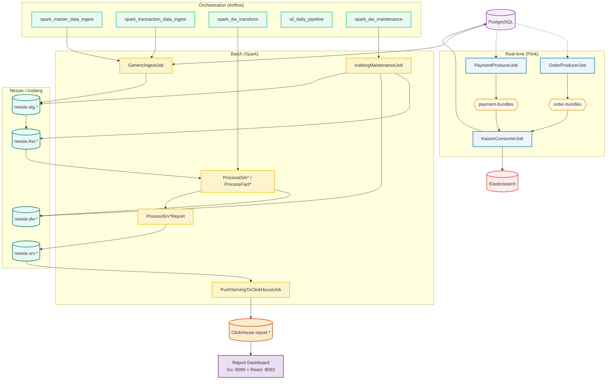

# Kaizen Data Platform — Kiến trúc & Hướng dẫn vận hành

**Kaizen Data Platform** là hệ thống xử lý dữ liệu thời gian thực và phân tích lô quy mô lớn, theo mô hình **Event-Driven Streaming & Modern Lakehouse Architecture**. Stack chính: Apache Flink (streaming), Apache Airflow (orchestration), Apache Spark (batch), PostgreSQL, Elasticsearch, Nessie/Iceberg, **ClickHouse** (serving/report hot layer) và **Report Dashboard** (Go API + React UI chạy local).

---

## Mục lục

1. [Kiến trúc & luồng dữ liệu](#1-kiến-trúc--luồng-dữ-liệu)
2. [Cấu trúc repository](#2-cấu-trúc-repository)
3. [Yêu cầu môi trường](#3-yêu-cầu-môi-trường)
4. [Clone & thiết lập lần đầu](#4-clone--thiết-lập-lần-đầu)
5. [Quick Start — Data platform](#5-quick-start--data-platform)
6. [Report Dashboard (local UI)](#6-report-dashboard-local-ui)
7. [Lakehouse DW (Nessie / Iceberg)](#7-lakehouse-dw-nessie--iceberg)
8. [Bảo trì & partition](#8-bảo-trì--partition)
9. [Flink streaming](#9-flink-streaming)
10. [Script deploy & tham chiếu](#10-script-deploy--tham-chiếu)

> **Hướng dẫn deploy tất cả features:** **[docs/DEPLOY.md](docs/DEPLOY.md)** — thứ tự greenfield, từng component, DAG, ports, checklist hàng ngày.

---

## 1. Kiến trúc & luồng dữ liệu

Hai luồng chính: **Real-time (Flink)** và **Batch Lakehouse (Spark + Airflow)**. Sau transform DW, dữ liệu serving được đẩy sang **ClickHouse** để phục vụ báo cáo qua **Report Dashboard**.



**Luồng báo cáo:** Spark transform → `nessie.srv.*` → `PushServingToClickHouseJob` → ClickHouse `report.*` → Go API → React UI.

---

## 2. Cấu trúc repository

```text
kaizen_data_platform/
├── dags/                              # Airflow DAGs & jobs (sync lên MinIO)
│   ├── jobs/                          # Python jobs, table_configs.yaml, clickhouse_utils
│   ├── pipelines/                     # DAG definitions
│   ├── schema_manager/clickhouse/     # DDL bundled cho Airflow (sync cùng DAGs)
│   ├── deploy_airflow.sh              # Upload DAGs → MinIO bucket airflow
│   └── config.k3s-new                 # kubeconfig (gitignore — copy thủ công)
│
├── projects/
│   ├── stream-processing/             # Flink (Java) + deploy_stream.sh
│   ├── batch-processing/                # Spark (Scala) + deploy_batch.sh
│   ├── backend/                         # Go Report API
│   ├── frontend/                        # React + Vite Report UI
│   └── run_local.sh                     # Một lệnh: CH + backend + frontend
│
├── schema_manager/                    # DDL toàn hệ thống
│   ├── postgres_source/               # PostgreSQL DDL
│   ├── elasticsearch/                 # ES index mappings
│   └── clickhouse/                    # ClickHouse DDL + views (source of truth)
│
├── clean_data.sh                      # Reset PG + ES (local, gitignore)
├── check_*.sh, clear_*.sh, ...        # Ops/monitor scripts (local, gitignore)
└── .gitignore
```

Chi tiết schema: xem [schema_manager/README.md](schema_manager/README.md).  
Chi tiết Report UI: xem [projects/README.md](projects/README.md).

---

## 3. Yêu cầu môi trường

### Dev chính (build + deploy K3s)

| Tool | Dùng cho |
|------|----------|
| **kubectl** + **kubeconfig** | Port-forward, deploy Flink/Spark pods |
| **Gradle** + **JDK 17+** | Build batch/stream JAR (không có `gradlew` trong repo) |
| **Go 1.21+** | Build Report API |
| **Node.js 18+** / **npm** | Frontend dev server |
| **mc** hoặc **aws cli** | Upload JAR/DAGs lên MinIO |

### Đồng nghiệp (chỉ xem report)

| Tool | Dùng cho |
|------|----------|
| **Tailscale** (cùng tailnet) | Kết nối ClickHouse qua NodePort |
| **Go** + **Node.js** | Chạy `./run_local.sh` |
| Không cần kubectl / kubeconfig | Dùng `backend/.env.tailscale.example` |

### Không có trong git (tự tạo khi build)

| Bị ignore | Tạo lại bằng |
|-----------|--------------|
| `**/.env` | Copy từ `.env.example` hoặc `.env.tailscale.example` |
| `**/build/`, `*.jar` | `gradle build`, `go build` |
| `node_modules/`, `dist/` | `npm install` |
| `dags/config.k3s-new` | Admin cung cấp riêng |

---

## 4. Clone & thiết lập lần đầu

```bash
git clone <repo-url> kaizen_data_platform
cd kaizen_data_platform

# kubeconfig — bắt buộc cho dev deploy (không có trong git)
cp /path/to/kubeconfig dags/config.k3s-new
# hoặc: cp ... ~/.kube/config.k3s-new

# Report UI — dev có kubectl
cd projects
cp backend/.env.example backend/.env    # localhost:9000, auto port-forward
./run_local.sh                            # → http://localhost:8092
```

**Đồng nghiệp (Tailscale only):**

```bash
cd projects/backend
cp .env.tailscale.example .env   # CLICKHOUSE_HOST=100.104.250.97, PORT=30900
cd .. && ./run_local.sh
```

---

## 5. Quick Start — Data platform

Thực hiện tuần tự trên máy dev (đã có kubeconfig):

### Bước 1: Dọn dẹp dữ liệu cũ (tùy chọn)

```bash
./clean_data.sh          # script ở root repo (local, không track git)
```

### Bước 2: Flink streaming

```bash
cd projects/stream-processing
./deploy_stream.sh stream
```

### Bước 3: Spark batch + Airflow DAGs

```bash
# Build & upload Spark JAR → MinIO bucket spark
cd ../batch-processing
./deploy_batch.sh deploy

# Upload DAGs → MinIO bucket airflow
cd ../../dags
./deploy_airflow.sh upload
```

### Bước 4: Chạy pipeline trên Airflow UI

1. Trigger **`master_data_pipeline`** — sinh master data PostgreSQL.
2. **`spark_master_data_ingest_pipeline`** — ingest master → `nessie.fnd.*`.
3. **`spark_transaction_data_ingest_pipeline`** — ingest giao dịch incremental.
4. **`spark_dw_transform_pipeline`** — transform DW + serving + push ClickHouse.
5. Hoặc để **`sil_daily_pipeline`** chạy tự động lúc 00:30 (ingest → transform).

### Bước 5: Xem báo cáo

```bash
cd projects && ./run_local.sh
```

Mở http://localhost:8092 — tab Financial Report & Fund Report.

---

## 6. Report Dashboard (local UI)

UI **không deploy lên K3s** — chạy local, đọc data từ ClickHouse trên cluster.

| Thành phần | Port | Mô tả |
|------------|------|--------|
| Frontend (Vite + React) | **8092** | Bảng báo cáo, format số |
| Backend (Go API) | **8090** | Query ClickHouse `report.*` |
| ClickHouse (kubectl forward) | **9000** | Native protocol — dev chính |
| ClickHouse (Tailscale NodePort) | **30900** | `clickhouse-shared` — đồng nghiệp |

**Kết nối ClickHouse (chọn một):**

| Ai | Cách | Config |
|----|------|--------|
| Dev có kubectl | `./run_local.sh` tự port-forward | `backend/.env` → `localhost:9000` |
| Đồng nghiệp Tailscale | Nối thẳng NodePort | `cp .env.tailscale.example .env` |
| LAN (không Tailscale) | NodePort IP LAN | `SKIP_K8S_FORWARD=1`, host + port 30900 |

```text
[Mac local]  run_local.sh
  frontend :8092  →  backend :8090  →  ClickHouse (K3s)
                                         ↑
                    Tailscale: 100.104.250.97:30900 (clickhouse-shared)
```

Hướng dẫn chi tiết: **[projects/README.md](projects/README.md)**

**Phân tích BI (Superset):** `./publish_superset.sh --force --embed` — xem [projects/docs/publish-superset.md](projects/docs/publish-superset.md)

---

## 7. Lakehouse DW (Nessie / Iceberg)

### Tầng Foundation (`nessie.fnd.*`)

Ingest incremental từ PostgreSQL qua `GenericIngestJob`, watermark `ModifiedDate`/`CreatedDate` hoặc khoảng `[fromDate, toDate)` từ Airflow params.

### Tầng Warehouse (`nessie.dw.*`)

Transform tuần tự để tránh nghẽn cluster:

`Product → Customer → Shop → Employee → Promotion → Voucher → Sales → Returns → Payments → Promotion Cost → COGS`

### Tầng Serving (`nessie.srv.*`) + ClickHouse

- `ProcessSrvFinancialReport`, `ProcessSrvFundReport` — aggregate serving trên Iceberg.
- `PushServingToClickHouseJob` — đẩy window 1 tháng sang ClickHouse hot layer (`report` database).
- DDL: `schema_manager/clickhouse/` — bảng native + views tiếng Việt.

**Ví dụ filter fact payment (chỉ SUCCESS):**

```scala
.filter((col("CreatedDate") >= fromTs && col("CreatedDate") < toTs) ||
        (col("ModifiedDate") >= fromTs && col("ModifiedDate") < toTs))
```

---

## 8. Bảo trì & partition

### Partition realignment (một lần)

DAG **`spark_dw_partition_realignment_pipeline`** — partition evolution theo ngày + rewrite data files:

```sql
CALL nessie.system.rewrite_data_files(table => 'tên_bảng')
```

### Daily maintenance (02:00 AM)

DAG **`spark_dw_maintenance_pipeline`**:

1. **Compaction** — gộp file Parquet nhỏ (~512MB).
2. **Expire snapshots** — giữ 5 snapshot (DW/FND), 1 snapshot (`stg.*`).
3. **Remove orphan files** — dọn file mồ côi trên object storage.

---

## 9. Flink streaming

| Job | Vai trò |
|-----|---------|
| `OrderProducerJob` | Giả lập đơn hàng Pareto 80/20 → Kafka `order-bundles` |
| `PaymentProducerJob` | Giả lập thanh toán → Kafka `payment-bundles` |
| `KaizenConsumerJob` | Consume → ghi PostgreSQL (JDBC) + Elasticsearch (nested docs) |

**FK integrity:** Consumer bỏ qua payment nếu order chưa tồn tại; simulator sinh lại ở tick sau.

Deploy: `projects/stream-processing/deploy_stream.sh {build|upload|stream|stop|clean}`

---

## 10. Script deploy & tham chiếu

### Script có trong git (sau `git pull`)

| Script | Mô tả |
|--------|--------|
| `projects/run_local.sh` | Report UI full stack |
| `projects/backend/deploy_backend.sh` | `build` / `run` / `clean` Go API |
| `projects/frontend/deploy_frontend.sh` | `run` / `build` / `clean` React |
| `projects/batch-processing/deploy_batch.sh` | Build Spark JAR + upload MinIO |
| `projects/stream-processing/deploy_stream.sh` | Build Flink JAR + deploy cluster |
| `dags/deploy_airflow.sh` | Sync DAGs + schema ClickHouse lên MinIO |
| `dags/patch_airflow_dag_sync.sh` | Patch sync DAG |

### Script ops ở root (local, không track git)

`clean_data.sh`, `check_nessie.sh`, `check_spark_cluster.sh`, `clear_nessie_*.sh`, … — giữ backup riêng hoặc copy từ máy dev chính sau clone mới.

### Services ClickHouse trên K3s (namespace `databases`)

| Service | Type | Port dùng |
|---------|------|-----------|
| `clickhouse-service` | ClusterIP | 9000 / 8123 (trong cluster, port-forward) |
| `clickhouse-shared` | NodePort | **30900** (native) / 30123 (HTTP) — Tailscale/LAN |

### Airflow DAGs chính

| DAG | Mô tả |
|-----|--------|
| `master_data_pipeline` | Sinh master data PG |
| `incremental_data_pipeline` | Sinh giao dịch incremental |
| `spark_master_data_ingest_pipeline` | Ingest master → FND |
| `spark_transaction_data_ingest_pipeline` | Ingest transaction → FND |
| `spark_dw_transform_pipeline` | DW + serving + push ClickHouse |
| `sil_daily_pipeline` | Daily 00:30: ingest → transform |
| `spark_dw_maintenance_pipeline` | Compaction + snapshot cleanup |
| `spark_dw_partition_realignment_pipeline` | Partition realignment (once) |
| `spark_transaction_simulation_pipeline` | Mô phỏng giao dịch batch |

---

## Liên kết nhanh

| Tài liệu | Nội dung |
|----------|----------|
| **[docs/DEPLOY.md](docs/DEPLOY.md)** | **Hướng dẫn deploy toàn bộ platform** |
| [projects/docs/publish-superset.md](projects/docs/publish-superset.md) | Publish Superset + BI embed |
| [projects/README.md](projects/README.md) | Report UI, Tailscale, ports |
| [schema_manager/README.md](schema_manager/README.md) | DDL Postgres, ES, ClickHouse |
| [projects/backend/README.md](projects/backend/README.md) | Go API endpoints |
| [projects/frontend/README.md](projects/frontend/README.md) | Frontend dev |
