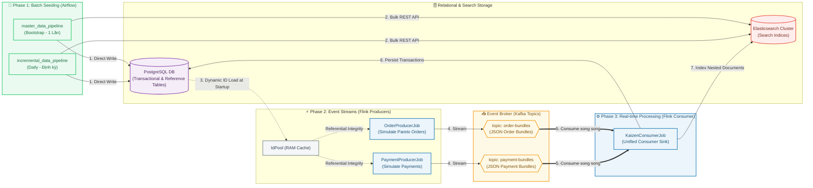

# 🚀 Kaizen Data Platform - Kiến Trúc & Hướng Dẫn Vận Hành

**Kaizen Data Platform** là hệ thống xử lý dữ liệu thời gian thực quy mô lớn, được xây dựng theo mô hình **Event-Driven Streaming Architecture**. Hệ thống tích hợp các công nghệ xử lý luồng (Apache Flink), điều phối lập lịch (Apache Airflow), xử lý lô (Apache Spark) cùng các kho lưu trữ PostgreSQL & Elasticsearch.

---

## 🗺️ 1. Kiến Trúc Hệ Thống & Luồng Dữ Liệu (Data Flow)

Kiến trúc dữ liệu được quy hoạch bài bản qua hai luồng xử lý bổ trợ nhau: **Batch Seeding (Airflow)** và **Real-time Event Streaming (Flink)**.



### Chi tiết luồng dữ liệu:
1. **Khởi tạo dữ liệu nền (Batch Load)**: Airflow sinh toàn bộ thông tin tĩnh (Wards, Products, Shops, Employees, Customers) ghi trực tiếp vào Postgres & Elasticsearch.
2. **Khởi động luồng Flink (Streaming Startup)**: Flink Producers kết nối tới Postgres qua `IdPool` để nạp danh sách ID thật vào bộ nhớ, đảm bảo toàn bộ giao dịch giả lập sau đó có tính toàn vẹn tham chiếu (Referential Integrity).
3. **Mô phỏng & Đẩy Kafka**: Đơn hàng ( Pareto 80/20) và thông tin thanh toán được đẩy liên tục lên Kafka.
4. **Tiêu thụ & Đồng bộ (Unified Consumer)**: `KaizenConsumerJob` đọc đồng thời các Kafka topics, ghi nhận giao dịch vào PostgreSQL (xử lý out-of-order bằng cơ chế stub-placeholder) và lưu trữ dạng nested JSON trong Elasticsearch.

---

## 📂 2. Cấu Trúc Mã Nguồn (Repository Layout)

Mã nguồn được tổ chức module hóa rõ ràng, loại bỏ hoàn toàn các file cấu hình dư thừa ở thư mục gốc:

```bash
implements_new_dataplatform/
├── dags/                        # Module điều phối và sinh dữ liệu nền (Airflow)
│   ├── jobs/                    # Các kịch bản python sinh master/incremental data
│   ├── pipelines/               # Khai báo cấu trúc các DAG lập lịch Airflow
│   ├── deploy_airflow.sh        # Script đồng bộ DAGs lên Kubernetes (qua MinIO)
│   └── requirements.txt         # Các thư viện Python cần thiết (Faker, psycopg2,...)
│
├── projects/
│   ├── stream-processing/       # Module xử lý luồng thời gian thực (Apache Flink - Java)
│   │   ├── src/main/java/       # Flink Jobs (Producers & Unified Consumer)
│   │   ├── src/main/resources/  # File cấu hình config.ini & log4j2
│   │   ├── deploy_stream.sh     # Script quản lý Flink (build, upload, start, stop, clean)
│   │   └── build.gradle         # Gradle cấu hình dependencies & shadowJar
│   │
│   └── batch-processing/        # Module xử lý lô phân tích (Apache Spark - Scala)
│       ├── src/main/scala/      # Các Spark Jobs làm sạch dữ liệu
│       └── deploy_batch.sh      # Script đóng gói và upload Spark JAR lên MinIO
│
├── schema_manager/              # Quản lý cấu trúc dữ liệu toàn hệ thống
│   ├── postgres_source/         # Các script DDL SQL khởi tạo bảng PostgreSQL
│   ├── elasticsearch/           # File JSON cấu hình Index Mappings & Settings cho ES
│   └── clean_data.sh            # Script dọn dẹp (truncate DB & clear ES document)
│
└── .gitignore                   # Cấu hình bỏ qua các file build/cache/credentials cục bộ
```

---

## 🛠️ 3. Hướng Dẫn Vận Hành Hệ Thống (Quick Start Playbook)

Thực hiện tuần tự các bước dưới đây trên terminal của máy host để khởi chạy hệ thống từ trạng thái sạch:

### Bước 1: Dọn dẹp dữ liệu cũ (Reset)
Nếu cần xóa sạch dữ liệu PostgreSQL & Elasticsearch để chạy lại từ đầu:
```bash
cd schema_manager
./clean_data.sh
```

### Bước 2: Biên dịch và Khởi chạy Flink Streaming
Di chuyển vào thư mục Flink, tiến hành build shadow JAR, upload lên MinIO và submit các jobs vào Flink cluster trên Kubernetes:
```bash
cd ../projects/stream-processing
./deploy_stream.sh stream
```
> [!TIP]
> Cờ `stream` sẽ thực hiện chuỗi lệnh tự động: Build JAR -> Upload lên MinIO -> Copy JAR vào Pod JobManager -> Khởi chạy 3 Jobs Flink -> Health check.

Kiểm tra xem cả 3 jobs Flink đã hoạt động ổn định ở trạng thái `RUNNING` chưa:
```bash
./deploy_stream.sh status
```

### Bước 3: Đẩy mã nguồn DAGs lên Airflow
Di chuyển vào thư mục `dags` và thực hiện upload các file DAG lên MinIO bucket (hệ thống Kubernetes sidecar sẽ tự động đồng bộ về các Pods Airflow sau tối đa 30 giây):
```bash
cd ../../dags
./deploy_airflow.sh upload
```
*(Chỉ chạy khi dựng hệ thống lần đầu)* Để thiết lập tự động đồng bộ và cấu hình cài đặt thư viện tự động cho Airflow Pods:
```bash
./patch_airflow_dag_sync.sh
```

### Bước 4: Kích hoạt Sinh dữ liệu nền (Airflow UI)
1. Truy cập vào giao diện Web UI của Airflow.
2. Tìm kiếm DAG `master_data_pipeline` và kích hoạt thủ công (**Trigger DAG**).
3. DAG này sẽ sinh ra dữ liệu master (Shop, Employee, Customer,...) nạp vào PostgreSQL & Elasticsearch.
4. Khi dữ liệu nền đã sẵn sàng, các Flink Producers sẽ tự động khớp ID và stream dữ liệu giao dịch về Kafka liên tục ở tốc độ cấu hình.

---

## ⚙️ 4. Tùy Chỉnh Tốc Độ Stream (Throughput Configuration)

Tốc độ sinh dữ liệu giao dịch giả lập được cấu hình tập trung trong tệp tin [config.ini](file:///Users/ricardokaizensiu/Documents/PersonalProject/features/implements_new_dataplatform/projects/stream-processing/src/main/resources/config.ini):

```ini
[flink]
parallelism = 1
checkpoint_interval_ms = 10000
emit_interval_ms = 1000      # Thời gian chờ giữa mỗi event (1000ms = 1 giao dịch/giây)
```

> [!NOTE]
> * `emit_interval_ms = 1000`: Hệ thống sẽ sinh chính xác **10 giao dịch mỗi 10 giây** (1 txn/s).
> * Để tăng tốc độ lên gấp 10 lần (100 giao dịch mỗi 10 giây), hãy sửa cấu hình thành `emit_interval_ms = 100`.
> * Sau khi sửa đổi `config.ini`, anh cần chạy lại `./deploy_stream.sh stream` để áp dụng cấu hình mới vào JAR.

---

## 🐞 5. Các Lỗi Thường Gặp & Cách Khắc Phục (Troubleshooting)

### A. Lỗi Vi Phạm Khóa Ngoại Out-of-Order Events (Stub Pattern)
* **Triệu chứng**: Giao dịch Payment đến trước Order, PostgreSQL ném lỗi vi phạm khóa ngoại `fk_order` hoặc lỗi `NOT NULL` với `EmployeeSaleId` / `ShopCode`.
* **Khắc phục**: 
  * Flink Job đã được triển khai **Stub-Placeholder Pattern**. Khi Payment đến trước, Flink sẽ tự tạo một đơn hàng tạm với trạng thái `PENDING_ORDER_DATA` và nạp động ID thực của Customer, Employee, Shop từ `IdPool` để thỏa mãn ràng buộc khóa ngoại.
  * Khi Order thực sự đến sau, cơ chế `ON CONFLICT` sẽ tự động ghi đè và cập nhật toàn bộ thông tin thật vào bản ghi đó.

### B. Lỗi Thiếu Tài Nguyên `NoResourceAvailableException`
* **Triệu chứng**: Một hoặc nhiều Flink Job không thể khởi chạy và ở trạng thái `FAILED` / `CREATED` do thiếu Task Slots trên cluster local.
* **Khắc phục**: Đảm bảo cấu hình `parallelism = 1` trong `config.ini` khi chạy môi trường Kubernetes local/K3s để tiết kiệm tài nguyên. Mỗi job lúc này chỉ tiêu tốn 1 slot.

### C. Lỗi Casting Driver PostgreSQL
* **Triệu chứng**: Lỗi `Cannot cast an instance of java.sql.Timestamp to type Types.TIMESTAMP_WITH_TIMEZONE`.
* **Khắc phục**: Toàn bộ mã nguồn Flink đã được refactor để chuyển đổi việc dùng `setObject` dạng ép kiểu tĩnh sang phương thức chuẩn **`setTimestamp`**. JDBC sẽ tự động ánh xạ kiểu thời gian sang cột `TIMESTAMPTZ` một cách an toàn mà không bị lỗi ép kiểu.
